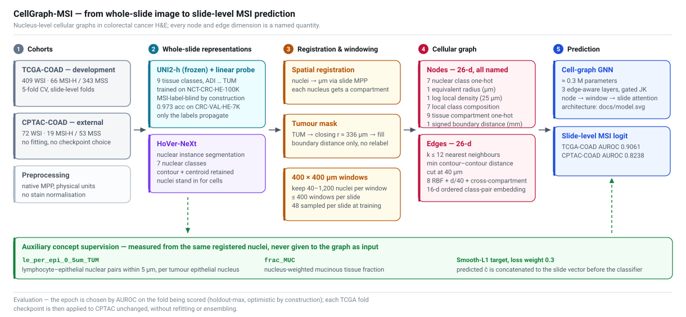
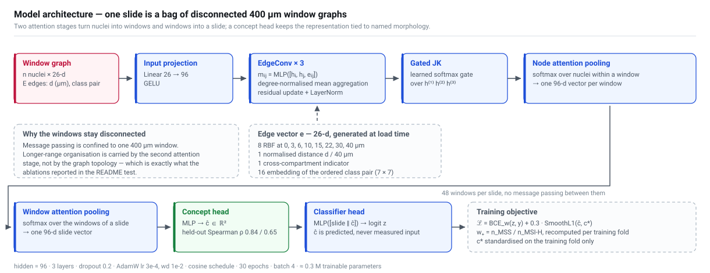
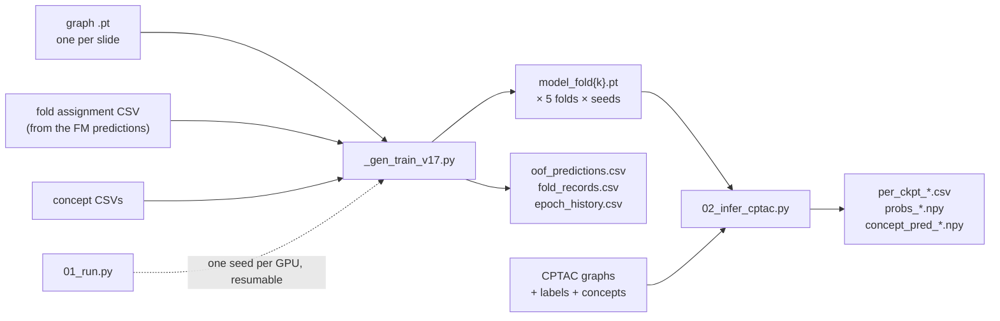

# CellGraph-MSI

**An interpretable, confound-screened cellular graph for microsatellite instability in colorectal cancer.**

[](LICENSE)


Reference implementation for the MSc dissertation *Cellular Spatial Network Analysis and Graph
Representation Learning in Histopathology Slides for Cancer Genomics* (UCL, Project P75).

Microsatellite instability (MSI) in colorectal cancer has a recognised histopathological phenotype,
yet most high-performing H&E models represent that information as latent visual features that
cannot be inspected biologically. This repository holds the predictive model from a study asking a
narrower question: **can an explicit nucleus-level cellular graph — one in which every node and edge
dimension is a named quantity — retain useful MSI signal while making the underlying morphology
auditable?**

The answer, on TCGA-COAD and CPTAC-COAD, is *substantially but not entirely*: AUROC 0.9061
internally and 0.8238 externally, below a strong visual foundation-model reference (0.9141 / 0.8707)
but above every other graph-based and handcrafted representation evaluated under the same protocol.

---

## Contents

- [Scope of this release](#scope-of-this-release)
- [Method](#method)
- [Results](#results)
- [How to read the numbers](#how-to-read-the-numbers)
- [Repository layout](#repository-layout)
- [Data contract](#data-contract)
- [Reproducing](#reproducing)
- [Provenance of the generated trainer](#provenance-of-the-generated-trainer)
- [Citation](#citation)
- [Data access, upstream models and licence](#data-access-upstream-models-and-licence)

---

## Scope of this release

This repository contains the **model, the training protocol and the external-evaluation
protocol** — the four scripts that turn pre-built cellular graphs into the reported numbers.

| File | Role |
| --- | --- |
| `_gen_train_v17.py` | The trainer. Dataset, model, 5-fold × multi-seed loop, checkpointing, reporting. |
| `_gen_train_v17_accum.py` | Identical, plus `--accum` for gradient accumulation, so the window count can be raised without changing the effective batch size. With `--accum 1` it is the same loop. |
| `01_run.py` | Resumable multi-seed launcher; one seed per GPU, one output directory per seed, pooled-OOF regression check against the recorded values. |
| `02_infer_cptac.py` | Applies TCGA-trained checkpoints to CPTAC, one checkpoint at a time, and reports per-checkpoint, seed-summarised and ensembled external AUROC plus concept recovery. |

**Not included in this release.** The upstream stages that produce the graphs and the CSV inputs
are not here: whole-slide preprocessing, the MSI-label-blind tissue probe, the HoVer-NeXt driver,
graph construction, the two concept measurements, the fold assignment, the reimplemented baselines
and the explainability pipeline. The [data contract](#data-contract) below specifies the exact
on-disk formats those stages must produce, so the model can be run against graphs built elsewhere.

---

## Method

<p align="center">
  
</p>

**Two whole-slide representations, kept separate.** Each H&E slide is processed at its native
microns-per-pixel into (i) a categorical tissue map from a linear probe on frozen UNI2-h features,
trained on NCT-CRC-HE-100K and validated on CRC-VAL-HE-7K (0.9726 accuracy, 0.9601 balanced
accuracy, zero NORM→TUM confusions), and (ii) nuclear instances from HoVer-NeXt, each with a
contour, a centroid and one of seven nuclear classes. Only the *categorical* tissue labels cross
into the graph; the UNI2-h embeddings never do. The probe never sees an MSI label, so tissue
context is not optimised against the target.

**Windows, not whole slides.** Tumour regions come from the TUM class. Because stromal gaps
fragment the raw TUM grid, a separate mask is morphologically closed (radius ≈ 336 µm) and
hole-filled — used *only* for signed boundary distance, never to relabel stromal nuclei as tumour.
Tumour tissue is cut into 400 × 400 µm windows; windows with fewer than 40 nuclei are dropped,
windows above 1,200 are subsampled, and at most 400 windows are kept per slide. Each window is an
independent graph with no edges to any other window, so a slide is a *bag of local graphs* rather
than one whole-slide network.

**Everything named.** A node is one nucleus carrying 26 explicit dimensions; an edge is a local
spatial neighbourhood (up to 12 nearest neighbours by minimum contour-to-contour distance, cut at
40 µm) carrying 26 more. No visual embedding enters the predictive graph. The exact layouts are in
the [data contract](#data-contract).

<p align="center">
  
</p>

**Hierarchical attention, not deeper topology.** Nodes are projected to 96 dimensions, updated by
three edge-aware message-passing layers, combined across depths by a gated jumping-knowledge
connection, pooled to a window vector by node attention, and pooled to a slide vector by window
attention. Roughly 0.3 M trainable parameters.

**Concept supervision.** With 66 positives, the model is pulled towards quantities already shown to
be real rather than towards memorising the positive slides. Two phenotypes selected from prior
colorectal pathology — not by screening the development cohort — are predicted as auxiliary
targets:

| Concept | Definition | Depends on cell classification? |
| --- | --- | --- |
| `le_per_epi_0_5um_TUM` | Lymphocyte–epithelial nuclear pairs within 5 µm, per tumour epithelial nucleus | Yes |
| `frac_MUC` | Nucleus-weighted fraction of nuclei in MUC-labelled tissue | No |

The measured values are **never given to the graph as input**. The concept head must recover them
from the cellular representation; the predicted vector is then concatenated to the slide vector
before the classifier. Training minimises

```
L = BCE_w(z, y) + 0.3 · SmoothL1(ĉ, c*)
```

with `w₊ = n_MSS / n_MSI-H` recomputed per training fold and `c*` standardised on the training fold
only. Both concepts were screened against sidedness, tissue source site, BRAF, KRAS and TMB, with a
within-MSS sidedness negative control.

---

## Results

### Common-protocol comparison

All rows share the same slides, the same five folds and the same checkpoint-selection rule, so they
are comparable to each other rather than to the figures in the original papers.

| Method | Representation | TCGA-COAD AUROC | CPTAC-COAD AUROC |
| --- | --- | --- | --- |
| FM | High-dimensional visual | **0.9141 ± 0.0239** | **0.8707 ± 0.0562** |
| **Cell-graph GNN (this repo)** | Nucleus-level cellular graph | 0.9061 ± 0.0509 | 0.8238 ± 0.0258 |
| WiKG | Feature-space patch graph | 0.8979 ± 0.0148 | 0.7774 ± 0.0602 |
| IDaRS<sup>†</sup> | Weakly supervised visual | 0.8933 | 0.7289 |
| SlideGraph∞ | Patch/region spatial graph | 0.8903 ± 0.0322 | 0.6431 ± 0.0948 |
| Wagner Transformer | High-dimensional visual | 0.8686 ± 0.0234 | 0.7577 ± 0.0299 |
| Two-phenotype LR | Explicit predefined scalars | 0.8297 ± 0.0353 | 0.6685 ± 0.0022 |
| Shen GCN2 | Nucleus-level graph | 0.8259 ± 0.0602 | 0.6817 ± 0.0712 |
| SNA + GBM | Handcrafted cell-network | 0.7743 ± 0.0493 | 0.6035 ± 0.0228 |
| MSAI-Path-style | Handcrafted pathological | 0.7634 ± 0.0754 | 0.6594 ± 0.0104 |
| Ding SPGNN | Patch-level spatial graph | 0.6229 ± 0.0827 | 0.5418 ± 0.0656 |

<sup>†</sup> Evaluated from released pretrained weights, so a single estimate rather than a
five-fold mean.

Transfer drop: the foundation model loses 0.043 and the cellular graph loses 0.082. The two
handcrafted phenotypes used directly in a two-variable logistic regression already reach 0.8297 —
most of the internal signal is reachable without any learned graph at all.

### Where the predictive information actually lives

Ablations, holdout-max AUROC, relative to the full model (0.9061):

| Arm | Removed or changed | Node dims | AUROC | Δ |
| --- | --- | ---: | ---: | ---: |
| Full model | — | 26 | 0.9061 | — |
| `L1_nodist` | Signed tumour-boundary distance | 25 | 0.9005 | −0.0056 |
| `L1_noedge` | **All three message-passing layers disabled** | 26 | 0.8931 | −0.0130 |
| `L1_reduced_class` | Nuclear-class one-hot + local composition | 11 | 0.8926 | −0.0135 |
| `L1_intrinsic` | Both of the above | 11 | 0.8873 | −0.0188 |
| `L1_noconcept` | Auxiliary concept supervision (0.3 → 0) | 26 | 0.8819 | −0.0242 |
| `L1_nocompart` | Tissue-compartment one-hot | 17 | 0.8744 | −0.0317 |
| `L0_tumwin` | Compartment + boundary distance | 16 | 0.8667 | −0.0394 |
| `L0` | Same, and windows sampled from whole tissue instead of tumour regions | 16 | 0.8476 | −0.0585 |

The ordering is the main scientific result of the ablation, and it is not the one the graph framing
would predict. Turning off **all** message passing costs 0.0130. Removing tissue context costs
0.0317, and sampling windows outside probe-defined tumour regions costs 0.0585 — four and a half
times more than the graph topology. **Local cellular and tissue context carry the signal; explicit
cell-to-cell message passing and whole-slide topology contribute comparatively little under this
construction.**

### Does concept supervision take?

Spearman correlation between predicted and measured concepts on held-out slides:

| Concept | With supervision | Without |
| --- | --- | --- |
| Short-range lymphocyte–epithelial proximity | ρ = 0.842 ± 0.035 | ρ = 0.106 |
| Mucinous tissue fraction | ρ = 0.651 ± 0.069 | ρ = 0.186 |

Without the auxiliary loss the representation does not encode these quantities in a recoverable
form. Both trainers print this check at the end of a run; a weak correlation means the auxiliary
loss did not take and the model is not constrained by the concepts it was meant to use.

### Random-seed robustness

| Run | AUROC | AUPRC | BalAcc | F1 |
| --- | --- | --- | --- | --- |
| Seed 0 | 0.8971 ± 0.0554 | 0.7265 ± 0.1210 | 0.7564 ± 0.0657 | 0.5836 ± 0.1237 |
| Seed 1 | 0.9103 ± 0.0473 | 0.7000 ± 0.1398 | 0.7796 ± 0.0744 | 0.6316 ± 0.1067 |
| Combined | 0.9037 ± 0.0491 | 0.7133 ± 0.1241 | 0.7680 ± 0.0673 | 0.6076 ± 0.1118 |

---

## How to read the numbers

These caveats are load-bearing. They are stated in the dissertation and repeated in the script
docstrings, and they should travel with any figure taken from here.

1. **The epoch is chosen on the fold being scored.** Checkpoints carry
   `selected_by="holdout_best"`. This is the protocol every baseline in the table above was
   re-evaluated under, so the comparison is internally fair — but the absolute values are
   optimistic and **must not be placed beside an inner-selected number**. With roughly thirteen
   positives per fold, AUROC moves several points between epochs, so a maximum over thirty epochs
   partly reflects that variation. The trainer prints the last-epoch AUROC alongside; the gap
   between the two is a reasonable reading of how much of the headline is selection.
2. **CPTAC took no part in that choice.** The external figures are uncontaminated. The internal
   reference they are subtracted from is not, so a transfer drop is an upper bound on the real one.
3. **Folds come from the foundation model's prediction file**, not from a split generated here, so
   every method is scored on exactly the same partition. The trainer exits if that file has no
   `fold` column.
4. **The dissertation's headline external figure (0.8238 ± 0.0258) is the five checkpoints of the
   primary run, not ensembled.** `02_infer_cptac.py` by default summarises fifteen checkpoints
   (3 seeds × 5 folds) and also prints a checkpoint-ensembled AUROC. These answer different
   questions and should not be mixed; select `--seeds` deliberately.
5. **Standardisation statistics are read from the checkpoint, never recomputed.** `node_mu/node_sd`
   and `concept_mu/concept_sd` were derived from each training fold and are not recoverable
   afterwards. Re-centring concepts on CPTAC's own statistics would absorb the domain shift under
   study into the transform and leave the drop unreadable; `02_infer_cptac.py` refuses to run
   against a checkpoint that lacks them.
6. **What the biology is and is not.** HoVer-NeXt performs *nuclear* instance segmentation, so
   nuclei stand in for cells throughout and the morphometry is nuclear. Edges are computational
   spatial neighbourhoods, not physical cell–cell contact. `le_per_epi_0_5um_TUM` is nuclear
   proximity, not a pathological count of intraepithelial lymphocytes. `frac_MUC` is a continuous
   tissue measurement, not the WHO diagnosis of mucinous adenocarcinoma.
7. **Model-level comparisons in the dissertation are descriptive.** No formal test of superiority
   or equivalence between predictive models was made, and the covariate screen tests robustness to
   *measured* covariates rather than causal independence.

---

## Repository layout

```
CellGraph-MSI/
├── _gen_train_v17.py         # trainer (generated; see provenance note)
├── _gen_train_v17_accum.py   # trainer + --accum gradient accumulation
├── 01_run.py                 # multi-seed, multi-GPU, resumable launcher
├── 02_infer_cptac.py         # external evaluation on CPTAC
├── docs/
│   ├── pipeline.svg
│   └── model.svg
└── LICENSE
```



---

## Data contract

### Graph files — `{graph_dir}/{slide_id}.pt`

A pickled dict, loaded with `torch.load(..., weights_only=False)`:

```python
{
  "node_dim": 26,                 # int; read back at inference, not stored in checkpoints
  "windows": [                    # one entry per retained 400 µm window
    {
      "n_nodes":     int,         # number of nuclei in this window
      "x":           Tensor[n_nodes, node_dim],  # float, unstandardised
      "edge_index":  Tensor[2, n_edges],         # long, local indices into this window
      "edge_d_um":   Tensor[n_edges],            # float, contour-to-contour distance in µm
      "rel":         Tensor[n_edges],            # long in [0, 49): id of the ordered class pair
    },
    ...
  ],
}
```

Windows are batched into one disconnected graph at collate time, with `node2win` and `win2slide`
index vectors tracking the hierarchy. Derived edge features are generated during the forward pass,
not stored.

### Node features — 26 dimensions

| Index | Dim | Feature | Definition |
| --- | ---: | --- | --- |
| `0:7` | 7 | Nuclear class | One-hot over the seven retained HoVer-NeXt classes: neutrophil, epithelial, lymphocyte, plasma cell, eosinophil, connective tissue, mitotic |
| `7` | 1 | Nuclear morphology | Equivalent circular radius `r = √(A/π)` in µm |
| `8` | 1 | Local nuclear density | `log(1 + n₂₅)`, nuclei within 25 µm |
| `9:16` | 7 | Local cellular composition | Proportion of each nuclear class within 25 µm |
| `16:25` | 9 | Tissue compartment | One-hot over ADI, BACK, DEB, LYM, MUC, MUS, NORM, STR, TUM |
| `25` | 1 | Tumour-boundary position | Signed distance to the processed tumour boundary, mm (negative inside) |

> The ordering follows Table 3.5 of the dissertation, and the compartment block is pinned in code
> by `COMPARTMENT_SLICE = (16, 25)`, which
> `CellGraphModel.edge_features` uses to derive the cross-compartment indicator. **A graph built
> with a different ordering will train without error and produce a silently wrong cross-compartment
> flag.** Node features are standardised per fold by `compute_norm`, which samples 40 training
> slides × their first 8 windows with a fixed seed.

### Edge features — 26 dimensions

Assembled in `edge_features()` at forward time:

| Dim | Feature | Definition |
| ---: | --- | --- |
| 8 | Distance RBFs | Centres at 0, 3, 6, 10, 15, 22, 30, 40 µm, width 4 µm |
| 1 | Normalised distance | `d / 40 µm` |
| 1 | Cross-compartment | 1 if the two nuclei fall in different tissue compartments |
| 16 | Class-pair relation | Learnable embedding of the ordered pair, 7 × 7 = 49 relation types |

Distance enters as a smooth basis rather than a single scalar so the layer can respond differently
at 3 µm and 30 µm without having to infer that shape from one number.

### CSV inputs

| Flag | Default path | Required columns |
| --- | --- | --- |
| `--labels-csv` | `splits/fold_0.csv` | `slide_id`, `msi_status` (`MSI-H` is the positive class) |
| `--meta-csv` | `data/labels/metadata_tcga_crc_dx.csv` | `slide_id`, `project_id` — used to filter to COAD |
| `--fm-csv` | `results_v7/v7b/code8_seed0/_pooled_predictions.csv` | `slide_id`, **`fold`** — the shared partition; also `base_prob` if `--fuse-fm-logit` |
| `--compartment-csv` | `v16/compartment_iel.csv` | `slide_id`, `le_per_epi_0_5um_TUM` |
| `--crosscheck-csv` | `v16/tissue/crosscheck.csv` | `slide_id`, `n_ADI` … `n_TUM` — `frac_MUC` is derived as `n_MUC / Σₜ n_t` |

`02_infer_cptac.py` takes the CPTAC equivalents via `--labels`, `--cptac-comp` and
`--cptac-tissue`, and builds `frac_MUC` by the identical formula so the two cohorts are measured
the same way.

### Checkpoints — `{out_dir}/{tag}_seed{n}/model_fold{k}.pt`

| Key | Contents |
| --- | --- |
| `state` | Best-epoch weights (not last-epoch) |
| `args` | Full `vars(args)` of the run |
| `selected_by` | `"holdout_best"` |
| `best_epoch`, `auc_best`, `auc_last` | Selection record for that fold |
| `node_mu`, `node_sd` | Node standardisation from the training fold |
| `concept_mu`, `concept_sd` | Concept standardisation from the training fold |
| `seed`, `fold`, `concepts`, `generation` | Provenance |

`node_dim` is *not* stored — the trainer inlines it at construction — so inference reads it back
from the graph files.

---

## Reproducing

### Environment

Plain PyTorch; there is **no PyTorch Geometric dependency** — message passing, segment softmax and
the hierarchical pooling are implemented directly with `index_add` and `scatter_reduce`.

```bash
python -m pip install torch numpy pandas scikit-learn scipy
```

PyTorch 2.x is assumed: the code calls `Tensor.scatter_reduce` and passes `weights_only=` to
`torch.load`. The published runs used 24 GB GPUs at the default configuration (48 windows, batch 4,
hidden 96); `CUDA_VISIBLE_DEVICES` must be set before the Python process starts. Raising
`--n-windows` raises peak activation memory proportionally; use `_gen_train_v17_accum.py` with
`--batch-size 2 --accum 2` to keep the effective batch at v17's 4 rather than confounding window
count with batch size.

### Layout

Every default path is relative, and `01_run.py` looks for the trainer at
`v32_final/_gen_train_v17.py`. Place the four scripts in a directory named `v32_final/` and run
from its parent, or override `--trainer`, `--out-root`, `--graph-dir` and the CSV flags.

### 1 — Smoke test (about two minutes)

```bash
CUDA_VISIBLE_DEVICES=0 python v32_final/_gen_train_v17.py \
    --seeds 0 --epochs 3 --n-windows 8 --batch-size 2 \
    --num-workers 0 --tag smoke
```

### 2 — Train

```bash
python v32_final/01_run.py --dry-run          # what would run, and what is already done
python v32_final/01_run.py --gpus 5 7         # three seeds across two GPUs
python v32_final/01_run.py --gpus 5 7         # again, to resume
```

Every hyperparameter is left at its default on purpose, so nothing can silently differ from the
published run: 48 windows, 30 epochs, batch 4, lr 3e-4, hidden 96, three layers, concept weight 0.3,
COAD only. Anything passed through `--extra` is flagged in the banner as not a default.

Resume is **per seed, not per fold**. `fold_records.csv` is written once, after all five folds of a
seed finish, so its presence with five rows is a reliable completion marker; a seed that died
part-way leaves checkpoints but no CSV and restarts from fold 0. About fifty minutes is the most
that can be lost.

Each seed gets its own `out_dir`. The trainer writes CSVs to `{out_dir}/{tag}/` — a path with no
seed in it — so running several seeds against a shared `out_dir` makes them overwrite one another's
`oof_predictions.csv` while the checkpoints survive. That is the failure mode this launcher exists
to prevent.

On completion the launcher compares each seed's pooled out-of-fold AUROC against the recorded value
with a tolerance of 0.02. GPU arithmetic is not deterministic, so these are targets to land near,
not values to match. A pooled OOF far outside tolerance means something other than nondeterminism
changed — library versions, the graph files, or the fold assignment — and should be resolved before
the external evaluation.

### 3 — External evaluation on CPTAC

```bash
python v32_final/02_infer_cptac.py --inspect   # checkpoint inventory and key check
python v32_final/02_infer_cptac.py --gpu 0
```

Two arms are configured:

| Arm | Tag | Trainer | Windows |
| --- | --- | --- | ---: |
| `w48` | `L1_concept` | `_gen_train_v17.py` | 48 |
| `w96` | `L1_concept_w96` | `_gen_train_v17_accum.py` | 96 |

Run `--inspect` first. It reports how many of the expected checkpoints exist and whether each
carries `selected_by`, `node_mu/node_sd` and `concept_mu/concept_sd`; a missing standardisation key
is a hard failure rather than something to work around, because wrong statistics at inference
produce a silent shift that looks exactly like failure to generalise.

Outputs land in `--out` (default `v32_final/ood`): `per_ckpt_{arm}.csv`, `probs_{arm}.npy`
(checkpoints × slides), `concept_pred_{arm}.npy` and `slide_order.csv`.

The concept-recovery block at the end is worth reading as a diagnostic rather than a formality.
`frac_MUC` is counted from tile labels and never passes through cell classification; the proximity
concept does. A split between the two localises external degradation to that channel.

---

## Provenance of the generated trainer

`_gen_train_v17.py` is a **generated file**. It was produced by `v22/02_retrain_v17.py` from
`v17/02_train_gnn.py` with two changes and nothing else: the best epoch's weights are kept, and a
checkpoint is written afterwards. Eleven invariants covering the training semantics are asserted by
that patcher. The original v17 numbers come from `graph_prob = best["p"]` — without capturing the
weights at that epoch, the model left in memory is the last epoch's and the checkpoint would not
match any reported figure.

The patcher and the original trainer are not part of this release. Edits belong in the patcher, not
in the generated file; the header of each generated script says so.

`_gen_train_v17_accum.py` adds only gradient accumulation, arranged so that `--accum 1` reproduces
the original loop exactly: each micro-batch contributes `loss / accum`, and gradient clipping moves
to just before the optimiser step so it acts on the same accumulated gradient the original clipped.

---

## Citation

```bibtex
@mastersthesis{tian2026cellgraphmsi,
  title  = {Cellular Spatial Network Analysis and Graph Representation Learning
            in Histopathology Slides for Cancer Genomics},
  author = {Tian, Bangxu},
  school = {University College London, Department of Computer Science},
  type   = {{MSc} dissertation},
  note   = {MSc Artificial Intelligence for Biomedicine and Healthcare, Project P75},
  year   = {2026},
  url    = {https://github.com/Abang111/CellGraph-MSI}
}
```

Supervisors: Dr Petru Manescu, Prof Delmiro Fernandez-Reyes, Prof Fabio Caccioli.

---

## Data access, upstream models and licence

**Cohorts.** TCGA-COAD diagnostic H&E slides from the [GDC Data
Portal](https://portal.gdc.cancer.gov/), with MSI status and clinicopathological annotations from
[cBioPortal](https://www.cbioportal.org/). CPTAC-COAD slides from the [Imaging Data
Commons](https://portal.imaging.datacommons.cancer.gov/). No slide images or patient-level data are
redistributed here.

**Upstream models and datasets.** HoVer-NeXt for nuclear instance segmentation and classification;
UNI2-h as the frozen encoder behind the tissue probe; NCT-CRC-HE-100K and CRC-VAL-HE-7K (Kather et
al.) for probe training and validation. Full citations are in the dissertation bibliography. Each
carries its own licence and terms of use, which apply independently of this repository's.

**Licence.** [Apache License 2.0](LICENSE).

**Acknowledgements.** UCL Computer Science Technical Support Group for compute. Results are based
in part on data generated by the [TCGA Research Network](https://www.cancer.gov/tcga) and the
Clinical Proteomic Tumor Analysis Consortium.
